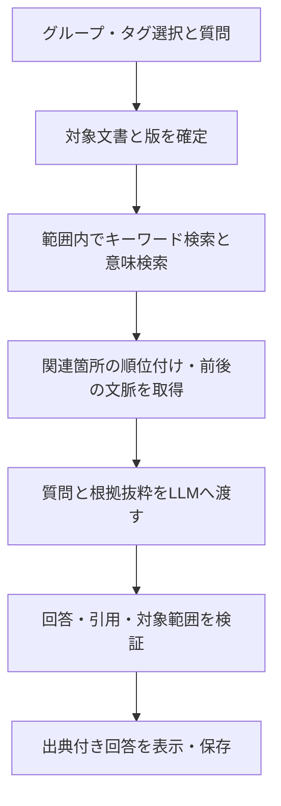

# リサーチ画面 開発計画書

作成日：2026年10月9日（日本時間）  
対象：既存OCR・文書管理アプリ `knowledge_base_system`  
状態：段階1のうち、リサーチ画面・資料選択・エディタとの往復・質問スレッドの作成／変更／削除／タグ設定・下書きの永続保存を実装済み。根拠検索とAI回答は後続工程。

## 1. 目的と推奨構成

既存アプリに独立した「リサーチ」画面を追加する。ユーザーが複数のタググループで文書群を指定し、質問すると、その範囲から関連箇所を検索・比較・分析し、出典を辿れる回答を表示する。

**推奨する初期構成は「文書管理・検索・出典管理をローカルで実施し、回答生成のみ外部LLMを利用する」方式とする。** 将来は回答生成の接続先をローカルLLMへ切り替える。検索データや会話履歴を特定の外部サービス専用の形式に依存させない。

初期仕様は次のように置く。

- 情報源は、選択した文書群の保存済みデータ。通常の回答にはWeb検索や未選択文書を混ぜない。
- グループ選択の下にタグ選択のプルダウンを置き、選択グループ内のタグだけを候補にする。リサーチ対象は明示的に選んだタグのいずれかが付いた文書とする。両方とも複数選択可。
- 回答は、資料に明記された内容・資料間の相違・そこからの推論・判断に不足する情報を区別する。
- 出典番号から、引用文、前後の文脈、元文書内の位置を確認できる。
- 文書本文を編集する既存画面と、リサーチの会話・調査メモを分ける。

## 2. 既存システムで確認できたこと

| 既存機能・構造 | リサーチ画面での扱い |
| --- | --- |
| FastAPIによるローカルAPI | 既存アプリにリサーチ専用のAPIを追加する |
| SQLiteの `documents`、`content_blocks`、`sections` | 文書・本文・見出しを情報源として利用する |
| `tag_groups` → `tags` → `document_tags` | グループ内のタグから対象文書を確定する |
| FTS5のtrigram全文検索と短語検索 | 固有名詞・日本語短語・数値の検索に利用する |
| 表、図版、注釈の保存 | 本文に加えて表の文字・関連する注釈を検索対象へ組み込む |
| 本文ブロックのページ番号・見出し・順序 | 出典の位置情報に利用する。欠けた位置情報は推測で埋めない |
| 文書保存時に本文ブロックを削除・再登録する処理 | 引用を現在のブロックIDだけに依存させず、文書の版と引用時の抜粋も保持する |

現在の `/api/search` は単一グループ名による文字列検索である。今回必要な複数グループ選択、自然言語の質問理解、意味検索、回答生成、回答と出典の対応は追加実装が必要。

主な確認箇所：`app/db_service.py` のスキーマ・`search_global`・`save_document_bundle`、`app/main.py` のタグ・検索API。

2026年10月9日の読み取り専用調査では、文書763件、タググループ6件、タグ46件、本文ブロック696,461件、本文約71,047,015文字。1ブロックの最大本文長は21,566文字で、ページ番号を持つブロックは690,482件だった。HTML本文も全ブロックに保存されている。この規模を前提に、初回索引化を再開可能な処理とし、索引の容量・検索速度を実測する。本文ブロック数と検索用文章単位数は同じではない。

## 3. 画面構成と操作

エディタ画面の画面切り替えに「リサーチ」を追加し、エディタからリサーチへ移動できるようにする。リサーチ画面の移動先はエディタ画面だけとし、上部に「エディタへ戻る」を設ける。仮の画面ファイル名は `research_form.html` とする。

- 画面の往復は「エディタ ⇄ リサーチ」とする。リサーチ画面にはOCRなど他画面への移動メニューを設けない。
- 出典の「元文書を開く」もエディタ画面へ移動し、その文書の該当箇所を表示する。
- 往復後もリサーチの選択条件・会話履歴を復元し、エディタ側も開いている文書・タブ・編集状態を保持する設計とする。

| 場所 | 表示・操作 |
| --- | --- |
| 左側：資料選択 | グループと配下タグの2段プルダウン（複数選択）。その下に質問スレッド一覧・新規作成・名前変更・タグ設定・削除。グループの組み合わせと対象文書一覧は設けない |
| 中央：質問と回答 | 質問欄、会話履歴、回答中の出典番号、停止・再試行、新しいリサーチの開始 |
| 右側：出典確認 | 文書名、見出し、確認できるページ番号、引用文、前後の段落、「元文書を開く」 |
| 上部 | 「エディタへ戻る」、リサーチ名、選択範囲、使用するAI、外部送信の有無、設定 |

基本操作：

1. タググループを選択する。
2. 下のプルダウンでグループ内のタグを選び、リサーチする範囲を指定する。
3. 質問を入力する。例：「開戦の原因について、資料間で一致する点と異なる点は何か」。
4. 「資料検索中」「関連箇所を比較中」「回答作成中」などの進行を表示する。
5. 回答の出典番号を選ぶと、右側に根拠の文章と文脈を表示する。
6. 「元文書を開く」でエディタ画面へ移動し、対象文書の該当箇所を表示する。位置を確定できない場合は見出しや引用文から確認できるようにする。
7. 続けて質問できる。追加質問でも選択範囲内を再検索し、前のAI回答自体を資料の代わりに扱わない。

文書の検索準備が未完了の場合は明示する。未処理文書を黙って除外して「全資料を調査した」と表示しない。

## 4. 文書選択の仕様

### 4.1 タググループと対象文書

タググループはタグの候補を絞るために選択する。グループだけの選択では文書を対象にせず、その下で明示的にタグを選択してリサーチ範囲を決める。

- 選択タグのいずれかが付いた文書を集める。同じ文書は1件にまとめる。グループのAND/OR切り替えと文書単位の除外操作は設けない。
- グループの選択を解除したら、そのグループ内の選択タグも解除する。選択グループ外のタグをリサーチに混入させない。
- 未選択または対象0件の場合は、対象を選ぶ案内を表示する。自動的にDB全体へ広げない。
- 対象文書の確定にはグループIDとタグIDを使い、同名のタグを区別する。
- 各質問の開始時に対象文書IDと版を確定し、途中で選択を変えても進行中の回答へ混ぜない。
- 選択を変えて続ける場合は、会話内に「資料の範囲を変更」と表示する。過去の回答の対象範囲は保持する。

初期版ではDBに登録された文書を対象とする。OCR作業フォルダーにだけ存在するページ結果は、文書としてDBへ取り込んでから利用する。未保存のエディタ編集も検索対象にはしない。

## 5. 質問から回答までの処理

### 5.1 検索用の文章単位

本文を見出し・段落・ページの情報を保ちながら検索用の小さな文章単位へ分割する。初期の目安は日本語600〜1,200文字程度、前後の重なり100〜200文字程度とし、実際には使用モデルのトークン上限と文章構造に合わせて調整する。

短い段落は周囲とまとめ、長い本文ブロックは文境界で分割する。文書をまたいだ結合はしない。複数ページにまたがる場合は、ページごとの原文範囲を保持する。

保存済みの本文テキストとHTMLの整合を確認してから索引化する。テキストボックス、表、脚注などが本文文字列に含まれていない場合も、元の位置・種別を保持した別の検索単位として取り込む。二重取り込みを防ぐ。

### 5.2 検索と比較

- 固有名詞・数値・年月日などは全文検索で探す。
- 言い換えや近い概念は意味検索で探す。
- 両方の候補を統合し、関連度と文書の偏りを見て順位付けする。
- **選択範囲の制約は候補取得時から適用する。** DB全体の上位結果を取得した後に選択範囲で削る方式は採らない。
- 検索候補の前後の段落・見出し・関連注釈を加え、文脈不足を防ぐ。
- 比較質問は必要に応じて複数の小さな問いに分け、同じ文書の重複引用だけで回答しない。

通常の質問応答は「質問に関連する箇所の調査」と位置付ける。「全資料の主張を網羅的に比較」する依頼は、文書ごとの抽出と統合を行う別の処理として扱い、時間と調査状況を表示する。上位数件の検索だけで網羅性を保証しない。

### 5.3 回答生成

LLMには、質問、必要な会話文脈、選択範囲から取得した根拠抜粋を渡す。出典に使えるIDもアプリが発行して渡す。

回答の基本形は「回答」「資料間の一致・相違」「補足と不足情報」。主要な事実記述に出典番号を付ける。資料から支持できない場合は「選択された資料からは確認できない」と答える。検索で見つからないことと、事実が存在しないことを区別する。

文書に含まれる指示文は情報源の文章として扱い、アプリへの命令として実行しない。

## 6. 出典の正確性と文書編集への対応

出典はLLMに書誌情報やページ番号を自由生成させず、取得済みの根拠データからアプリが組み立てる。

| 出典として保存するもの | 用途 |
| --- | --- |
| 文書ID、引用時の文書名、文書内容の版・ハッシュ | どの文書のどの状態を参照したか特定する |
| 検索単位ID、元ブロック・表・注釈のIDと位置 | 元文書の対応箇所へ移動する |
| 見出し階層、ページ情報、段落位置 | ユーザーが根拠を探せるようにする |
| 原文の引用文、前後の抜粋、原文内の範囲 | 引用を照合し、過去の回答を再確認する |
| 回答中の主張と出典IDの対応 | 何の根拠か分かるようにする |

ページ番号は、PDFのファイル内ページ、本文に印刷されたページ、DOCXの保存位置などを混同しない。取得できない印刷ページ番号は作らず、見出し・段落位置を表示する。エディタで修正した本文と原本が異なる場合は「保存済み編集本文」を根拠にしたことを表示する。

生成後に、出典IDが渡した候補内にあること、選択範囲内であること、引用が原文の対応箇所と一致することを機械的に検証する。説明文をその引用が意味的に支持しているかは別に評価する。IDや引用の一致だけで回答の正しさを保証しない。

保存後に文書が編集された場合、過去の回答は引用時点の抜粋を保持し「現在の文書は更新されています」と表示する。現在の文書への移動は版と位置を照合し、対応が取れない場合は引用時の抜粋を表示する。削除後も引用記録が残ることを明示し、必要に応じてリサーチ記録も削除できるようにする。

## 7. ローカルLLMへの移行設計

検索処理と生成処理を分け、次の役割ごとに交換可能にする。

| 役割 | 初期案 | 将来の変更 |
| --- | --- | --- |
| 回答生成 | クラウドLLMへの接続。最初の候補はGemini API | Ollamaなどで動くローカルLLMへの接続を追加 |
| 意味検索用の文章数値化 | 日本語に対応するローカル埋め込みモデルを優先し、CPUでも実測する | 別モデルへ変更する場合は索引を別世代として再生成 |
| キーワード検索 | SQLite FTS5 | 原則維持 |
| ベクトル検索 | 選択範囲で絞れるローカル検索基盤 | 件数・速度の実測に応じて検索実装を交換 |
| 候補の再順位付け | 検索スコア統合。必要に応じてローカルモデルを追加 | 品質・速度に応じて差し替え |
| 出典管理・会話保存 | アプリ独自の共通形式 | LLM変更後も維持 |

コード上の役割は `GenerationProvider`、`EmbeddingProvider`、`Retriever`、`Reranker` に分ける。回答形式は共通の構造とし、接続先・モデル名・使用量・停止理由・タイムアウトを共通の形で扱う。

GeminiとOllamaには構造化出力の機能があるため、回答と出典IDの対応を受け取る候補になる。ただし対応する形式やモデルの能力は同一とは限らず、アプリ側で検証する。[Gemini公式資料](https://ai.google.dev/gemini-api/docs/structured-output)、[Ollama公式資料](https://docs.ollama.com/capabilities/structured-outputs)

Ollamaは埋め込み生成も提供する。生成用モデルと埋め込み用モデルは別に管理し、クラウドからローカルへ回答生成を切り替えるだけなら、埋め込み索引を作り直す必要のない構成にする。[Ollamaの埋め込み公式資料](https://docs.ollama.com/capabilities/embeddings)

埋め込みモデルを変更するときは、モデル・バージョン・次元数・正規化方法を含む索引識別子を変える。異なるモデルの数値を同じ索引に混ぜない。新索引の生成・検証後に切り替え、旧索引に戻せるようにする。

ローカル化の完了条件は、回答生成だけでなく、検索・埋め込み・順位付けもネットワーク接続なしで動作すること。モデルの初回取得後、外部通信を禁止した状態で確認する。外部LLMへの自動切り替えはしない。

### 実装の分担案

| 追加する構成 | 責務 |
| --- | --- |
| `research_form.html` | 資料選択、対話、出典プレビューの画面 |
| `app/research/routes.py` | 選択条件・検索・質問ジョブ・進捗取得・停止のAPI |
| `app/research/indexing.py` | 原文の分割、位置対応、差分索引化、再開処理 |
| `app/research/retrieval.py` | 対象範囲を守った全文・意味検索と順位付け |
| `app/research/service.py` | 質問から回答までの進行、予算、会話文脈の管理 |
| `app/research/citations.py` | 引用照合、出典組み立て、原文への移動情報 |
| `app/research/providers/` | 外部・ローカルの生成、埋め込みへの接続 |
| `app/research/store.py` | 会話、引用、索引世代、ジョブ状態の保存 |

APIは、対象文書の事前確認、根拠検索、質問の開始、ジョブ状況取得、停止、履歴取得を分ける案とする。画面を閉じてもジョブを識別できるIDを返し、再送による二重処理を防ぐ。既存APIと同じ認証を適用し、外部LLMのAPIキーはサーバー側で扱う。これらのファイル名・API分割は実装時に調整する設計案であり、現時点で追加済みではない。

## 8. 保存・索引更新・長時間処理

既存の `data/my_notebook.db` を文書の正本とする。検索用の文章単位、ベクトル、リサーチ履歴、引用抜粋は、追加の `data/research.db` と必要なローカル索引ファイルへ保存する案を推奨する。再生成できる索引と、再生成できない会話・引用記録はバックアップ対象を分ける。

保存対象は次のとおり。

- 文書ごとの索引状態、内容ハッシュ、索引の世代、処理エラー。
- 検索用文章単位、出典との対応、使用した埋め込みモデルの識別子。
- リサーチごとの名称・選択条件・対象文書・会話履歴。
- 質問ごとの対象文書の版、回答、引用時点の根拠、使用モデル、使用量。

文書保存・取り込み・削除の完了時に、索引更新の必要性を記録する。必要なら既存DBの保存トランザクション内に小さな更新通知テーブルを追加し、本文保存後にプロセスが終了しても通知が失われないようにする。全文検索DBと追加DBの更新が同時に成功すると仮定しない。

起動時にも内容ハッシュと索引状態を照合し、古い索引を検出する。更新中は旧版・新版の文章を混ぜず、文書単位で新しい索引へ切り替える。古い索引しかない文書は状態を表示し、準備完了を待つか、対象を明示して除外する。

タグだけの変更では本文の数値化をやり直さず、対象文書集合を再計算する。文書削除は検索対象へ即時反映する。

初回索引化はバックグラウンドのジョブとし、進捗・一時停止・中止・再開・失敗箇所の再実行を可能にする。ページの再読み込みで処理状況や確定済み結果を失わない。LLM回答もジョブIDで管理し、接続断時に状況を再取得できるようにする。

## 9. 外部LLM利用時の扱い

初期設定時に、送信先と「質問・必要な会話文脈・検索した文書抜粋が外部へ送られる」ことを明示して利用を選択できるようにする。文書全文の一括アップロードは初期方式にしない。必要最小限の抜粋をアプリ側で選ぶ。

APIキーはブラウザー内や文書DBに埋め込まず、サーバー側の資格情報として保存する。送信先・保持条件・料金は接続先の選定時に確認する。質問あたりの送信量、出力量、再試行回数に上限を設け、使用量を確認できるようにする。再試行により重複課金が発生し得る操作は無制限に繰り返さない。

接続先の変更で画面の操作や引用形式は変えない。出典のない回答、設定していない外部サービスへの送信、外部サービスの障害を理由にした無断の切り替えを避ける。

## 10. 実装の段階と成果物

| 段階 | 作業内容 | 完了の判断 |
| --- | --- | --- |
| 0：現状調査と試験資料 | 文書量・本文長・位置情報・日本語検索品質・PC性能を調査し、代表的な質問と正しい根拠を用意する | 実際の文書による評価基準、初期モデル候補、索引方式を決められる |
| 1：資料選択と根拠検索 | リサーチ画面、グループ・タグの2段選択、文章分割、全文・意味検索、出典プレビュー、索引更新を実装する | AI回答なしでも、選択範囲から必要な箇所を探し元文書へ辿れる |
| 2：出典付き回答の初期版 | 外部LLM接続、根拠付き回答、出典検証、停止・再試行、会話保存、追加質問を実装する | 選択範囲内の根拠に基づく対話を行え、根拠不足も表示できる |
| 3：調査機能の拡張 | 文書間比較、全資料を対象にした段階的調査、調査メモ・回答の出力、必要に応じた表・注釈処理の強化 | 調査範囲と進捗が明確な比較・整理ができる |
| 4：ローカル生成へ移行 | ローカルLLM接続、PCに合うモデルの実測、出典形式と検索品質の再評価を行う | 外部通信なしで選択・検索・回答・出典確認・履歴保存が完結する |

実用初期版は段階2までを対象とする。段階1の検索精度を確認してから回答生成を組み合わせる。画像そのものの理解、図からの数値読み取り、Webリサーチ、音声要約は初期版の必須項目に含めず、別の拡張として扱う。

工期・初回索引化時間・API費用は、段階0で文書量とPC性能、候補モデルの実測から見積もる。現時点で固定した日数や速度を約束しない。

## 11. 検証項目と受け入れ基準

次の数値は実測値ではなく、実装時に評価する初期目標とする。

| 観点 | 検証・受け入れ基準 |
| --- | --- |
| 選択範囲 | 単一・複数タグ・重複・対象0件・グループ解除・同名タグを検証。未選択タグや選択グループ外のタグの文書を、検索・送信・回答に混入させない |
| 検索品質 | 正解の根拠を人が指定した日本語質問30〜50件を用意。上位20候補に必要な根拠が入る質問の割合90%以上を初期目標にし、固有名詞・言い換え・短語・OCR誤字を別集計する |
| 回答の裏付け | 実在する出典だけを付ける。機械検証可能な引用一致・範囲一致は全件必須。主要な事実記述を根拠が支持するかは人が評価する |
| 不足・相違 | 根拠なしの質問に断定しない。資料の矛盾や異なる時点の記述を混ぜて一つの事実にしない |
| 位置情報 | ファイルページと印刷ページを区別。位置不明を捏造せず表示。編集・削除後も過去の引用を誤った現在位置へ飛ばさない |
| 更新 | 本文編集・再取り込み・タグ変更・削除後に、対象文書と索引の状態が正しく反映される |
| 長時間処理 | 再読み込み、通信断、停止、再開、部分失敗を検証。索引の未完成部分を完成扱いしない |
| モデル交換 | 外部とローカルで同じ回答・出典の共通形式を利用でき、変更した箇所以外のデータを作り直さず動く |
| 保護 | 既存本文・OCR結果・タグをリサーチ操作で上書きしない。文書内の命令文やHTMLがアプリ操作として実行されない |
| 画面移動 | エディタからリサーチへ移動できる。リサーチからの移動先はエディタだけ。出典からの移動もエディタへ統一し、往復で編集状態・選択条件・会話履歴が失われない |

応答速度は「資料検索」「生成」「初回索引化」を分けて記録する。速度の評価条件には対象文書数、文章単位数、PC、モデルを併記する。

## 12. 実装に入る際の既定案

1. エディタから移動できる独立したリサーチ画面を追加する。リサーチ画面からの移動先はエディタ画面だけとする。
2. グループとタグを別々のプルダウンで複数選択する。選択タグのいずれかが付いた文書を対象にし、グループの組み合わせ欄と対象文書一覧は設けない。
3. 検索と出典管理をローカルに置き、まずGemini APIを接続候補として出典付き回答を実装する。
4. 意味検索の埋め込みはローカルを優先し、日本語検索品質と処理時間を実測して採用モデルを決める。
5. 追加のリサーチ保存領域を用意し、既存文書DBは正本として保持する。
6. 実装前バックアップは既定の `C:\Users\natur\BackUp\OCRアプリ` に保存する。

最初の実装着手点は、**「グループ・タグの選択 → 対象文書の確定 → 根拠検索 → 元文書の該当箇所を開く」** の一連の動作とする。ここを確認してからLLM回答を加える。

## 13. 実装状況（2026年10月9日）

最初の依頼「まずリサーチ画面を作る」に対応し、次をアプリに反映済み。

- エディタ上部に「リサーチ」を追加。リサーチの移動先は「エディタへ戻る」のみ。
- 資料・質問と回答・出典の3領域を用意。検索・AI回答・出典表示が未接続であることを画面に明記。
- 既存DBから6タググループ・763文書とタグのメタデータを読み込み、グループの下で配下のタグを複数選択できる2段プルダウンを実装。対象文書は重複除去する。
- グループやタグが未選択のときは対象0件。グループを外すとその配下の選択タグも外れる。グループの組み合わせ欄・対象文書一覧はユーザーの最新指示に従って削除済み。
- タイトル・質問の下書き・グループとタグの選択をスレッドごとに専用の `data/research.db` へ保存。プルダウンの下に一覧を表示し、切り替え・新規作成・名前変更・タグ設定・削除と直後の取り消しを実装。
- 旧ブラウザー下書きのタイトル・質問・選択条件は初回にスレッドへ移行。保存前の編集はブラウザーにも退避する。旧AND/OR・文書除外は引き継がない。
- エディタ内の全画面ダイアログに独立したリサーチ画面を表示し、エディタのDOMと開いているタブを保持。未保存のタイトル・本文が往復後も残ることを実画面で確認。
- 再読み込み後もリサーチの選択・質問の下書きが復元されることを確認。エディタの未保存編集を再読み込みから保護する機能とは別。

文書DBの本文・タグ・OCR結果は変更していない。リサーチ専用DBはスレッドと下書きの保存用として作成済み。検索索引、会話メッセージ・回答の保存、外部サービスへの送信、AI接続はまだ実装していない。

バックアップ：`C:\Users\natur\BackUp\OCRアプリ\research_screen_20261009_164114`。詳細は `引き継ぎメモ_リサーチ画面_2026-10-09.md`。

## 14. 根拠検索の初期実装（2026年10月9日）

「レイアウトは完了。次に進める」に対応し、段階1のうち、選択タグ内の本文検索・引用表示・元文書への移動を反映した。第13節の「検索・出典表示が未接続」は初期画面実装時の状態。

- 質問・語句からローカルで検索語を取り出し、既存の日本語trigram全文索引を使用する。1〜2文字は選択文書の本文を直接照合する。「 」で囲った語句は一つの検索語として扱う。
- 対象範囲はサーバーで検証し、候補件数の制限前に選択タグの文書へ限定する。検索候補は全文索引・短語照合それぞれ最大160箇所、引用表示は最大20件。全件調査や意味検索ではない。
- 質問と検索結果を専用DBに保存し、スレッド別に履歴を復元する。現状は最新50件の履歴を一覧取得し、選んだ質問の出典を表示する。
- 引用は最大1000文字の本文抜粋、文書名、見出し、保存本文のページ、ブロックID、更新日時、本文ハッシュ、抜粋位置を検索時の状態で保持する。HTMLとして実行せず文字として表示する。
- 「本文で開く」でエディタの隣の文書タブに開き、一意に一致する引用を選択する。更新・削除・一致位置不明の場合はその旨を表示し、位置を推測しない。未保存の新規文書がある場合は保存後に開く案内を出す。
- 検索器は `EvidenceRetriever` の共通契約で分離し、回答生成とは独立。外部通信・LLM接続・意味検索モデルの導入は行っていない。

実際の「水」タグ3文書で、語句検索・引用表示・再読み込み・スレッド切替・範囲変更時の区別・本文の引用選択・隣の文書タブ表示を確認。試験用の別DBで範囲外の候補が多いケース、短語、検索式文字列、改訂・削除後の引用保持、履歴と競合を検証済み。

**段階1全体は継続中**。次は文章分割と意味検索、検索品質評価、索引更新・失敗時の運用を整える。その後、段階2のAI回答を接続する。キーワード検索の速度を意味検索やAI回答の速度として扱わない。

## 15. 意味検索の初期実装（2026年10月9日 18:40）

ユーザーの「うまく検索できています。進めてください」に対応し、段階1の文章分割・ローカル意味検索・索引準備を追加した。第14節までの「意味検索未実装」は過去の状態。

- 日本語対応 `intfloat/multilingual-e5-small` の固定版を量子化ONNXで実行。初回にモデルを取得した後は、本文・質問を外部に送信せずCPUで処理する。OCRの実行環境とは別の専用環境に分離した。
- 同一ページ・見出し内の隣接段落をまとめ、最大1000文字の原文範囲をさらにモデルのトークン数に合わせて重複付きで分割。複数ブロックのID・ハッシュ・文字位置を保持する。ページや見出しをまたいで引用を合成しない。
- サーバーで選択タグの文書集合を確定し、その集合内だけで意味検索する。従来の本文検索との順位を統合し、最大20候補を表示。「本文一致」「意味が近い候補」を区別し、検索時の準備済み文書数も保持する。
- 初回準備はバックグラウンドで実行。画面に文書数・進捗・停止・再開・失敗時の再試行を表示。準備中も本文検索を使用できる。確定済みの文章単位を保存し、再開時に再利用する。
- 索引は再生成可能な `data/research_index.db` に分離。本文ハッシュとモデル識別子で世代を照合し、未完成・古い世代は検索しない。タグ変更時は対象集合を再計算し、本文の数値化を繰り返さない。
- 本文更新はリサーチを開く・資料を選ぶ・検索する際に検出する。検索時は全対象文書の内容ハッシュを照合し、同じ更新日時の差し替えも検出。常時監視や既存保存処理への通知追加はまだ行っていない。
- 実資料「水」3文書640文章の初回準備は約55秒、準備済みの3質問は約0.07〜0.29秒を一度実測。PCの負荷・文書量で変動する。別途、作成した日本語質問30件の意味検索動作確認を実施したが、実資料で人が根拠を指定する第11節の品質評価を代替しない。
- 実画面で本文検索＋意味検索、再読み込み後の履歴、複数段落の引用選択、エディタ往復、停止・再開を確認。試験用DBで範囲隔離・更新・削除・再開・モデル世代・引用保持を確認。

**段階1の機能の初期実装を反映済み**。大きな資料範囲の初回準備は継続中であり、代表的な実資料での検索品質評価は残る。AIによる回答・分析文・追加質問の文脈処理は未実装。次は段階2の出典付き回答へ進む。接続先・APIキー・外部送信の設定は回答生成の接続時に扱う。詳細とバックアップは最新の引き継ぎメモを参照。

## 16. 出典付きAI回答の初期実装（2026年10月9日 19:20）

ユーザーがGemini APIと質問・必要な抜粋のGoogleへの送信を承認したため、段階2の機能を反映した。第15節までの「AI回答未実装」は過去の状態。

- AI設定にAPIキー登録、モデル変更、利用と送信の有効化、キー削除を追加。キーはWindows DPAPIで暗号化してローカルに保存し、画面やAPIから値を再表示しない。
- 選択タグの検索結果から最大12件の必要な抜粋を使い、段落ごとに出典番号と引用を伴う回答を作成する。質問直下に回答を表示し、番号から右側の出典へ移動できる。
- 続きの質問では前の1質問・回答を文脈として使い、新しい根拠を検索する。スレッド別の回答履歴、再読み込み、停止、手動再試行、根拠不足の表示に対応。
- 送信前後に本文・タグ・引用位置を照合し、出典IDと引用文の一致を機械検証する。不正な引用や変更された根拠では回答を確定しない。引用一致が主張の意味的な裏付けを保証するものとは扱わない。
- 生成器はGenerationProviderの契約で検索と分離。初期実装はGemini、既定モデルはgemini-3.8-flashで変更可能。将来のローカル生成でも共通の資料・回答・出典形式を使う。ローカル生成器の接続自体は未実装。
- 自動の課金再送を避け、同一要求IDの重複を抑止する。停止・再起動による中断を保存し、再試行は利用者の操作で行う。

試験用DBと仮の応答で、認証・暗号化・範囲隔離・引用検証・追加質問・保存・停止・再試行・改訂・削除・起動中断を検証し、ブラウザーでも回答と出典の動作を確認した。実アプリの既存質問・検索履歴・文書は維持している。

**実装は反映済みだが、実際のGemini接続と回答品質の確認は未完了。** 現在はAPIキー未登録・利用無効であり、外部生成要求は送っていない。ユーザーが編集を保存して再読み込み後、リサーチの「AI設定」でキーを登録し利用を有効にすれば、実接続の確認へ進める。続いて第11節の実資料30〜50質問による品質評価を行う。詳細・確認結果・バックアップは引き継ぎメモの最新節を参照。

### 実接続の確認（2026年10月9日 22:45）

ユーザーのキー登録後、新形式キーの入力チェックとGeminiへ送る回答形式の列挙値を修正した。保存済みキーと試験用の短い資料で実Geminiから正常なJSON回答を受信し、出典IDと引用の一致まで確認済み。上記の「キー未登録・実接続未確認」は過去の状態。キーの値は表示せず、実会話や文書を試験で変更していない。実資料30〜50質問での検索・回答品質評価は継続課題。

2026年10月9日23:07追記：元モデル3.8が同じ実質問でHTTP503混雑を2回返すことを確認。3.5 Flash-Liteでは同じ質問・12抜粋で回答と原文引用の一致を確認できたため、承認付きで利用設定をgemini-3.5-flash-liteへ切替。キーと会話履歴は保持。エラー表示も混雑・内部障害・時間切れを区別し、HTTP状態を記録するよう修正した。自動送信や自動モデル切替は追加していない。実資料の1質問での確認を行ったが、代表質問群による品質評価は引き続き必要。

2026年10月9日23:14追記：原文引用の書き写し不一致を避けるため、Geminiは原文候補のIDを選択し、アプリがそのIDに対応する原文を引用として表示する方式へ変更。従来の原文照合や改訂検出は維持する。直前に失敗した実質問で生成・原文一致・実アプリの会話への保存と再取得に成功した。引用の文字一致と主張の意味的な裏付けは区別し、品質評価は継続する。
